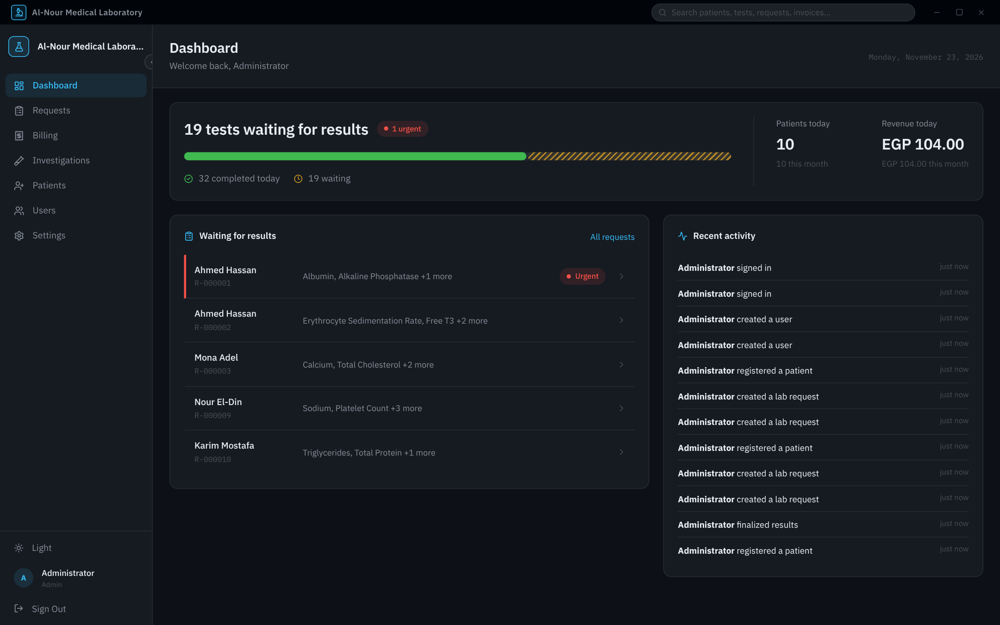
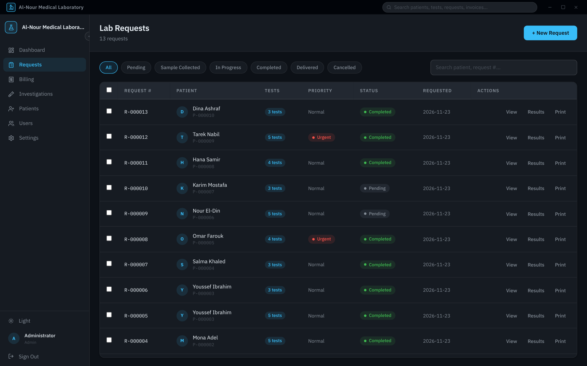
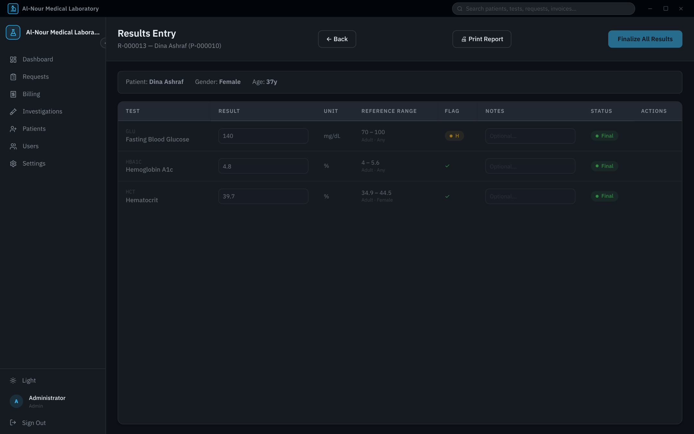
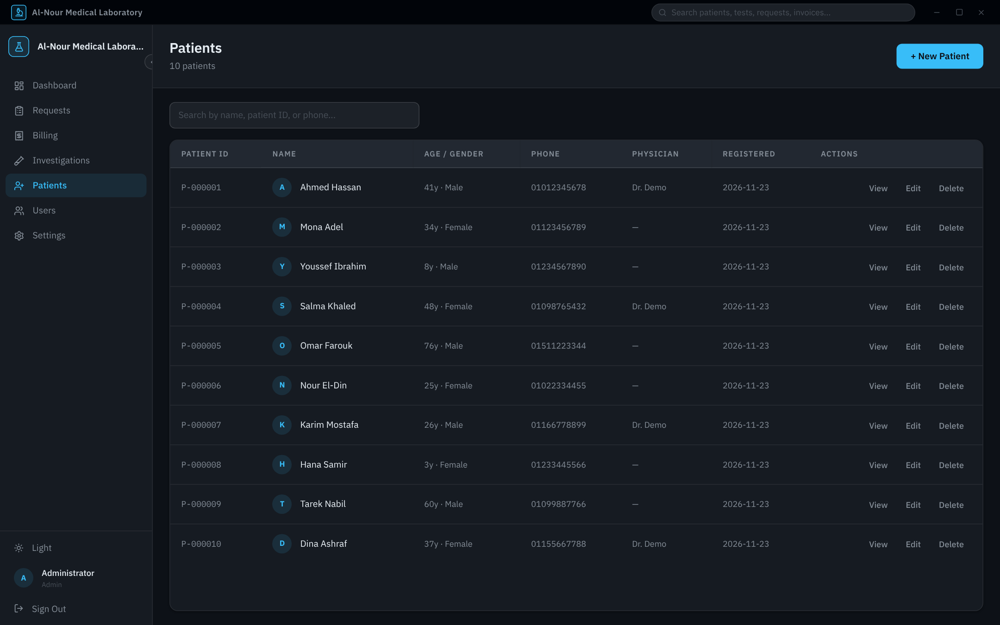
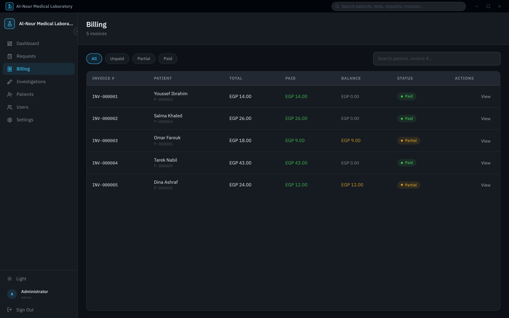
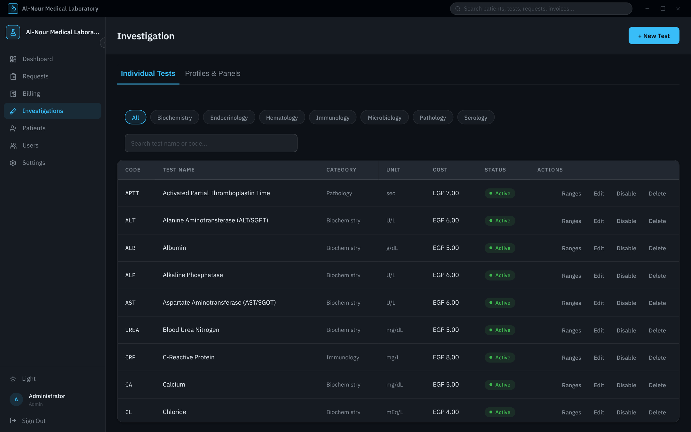
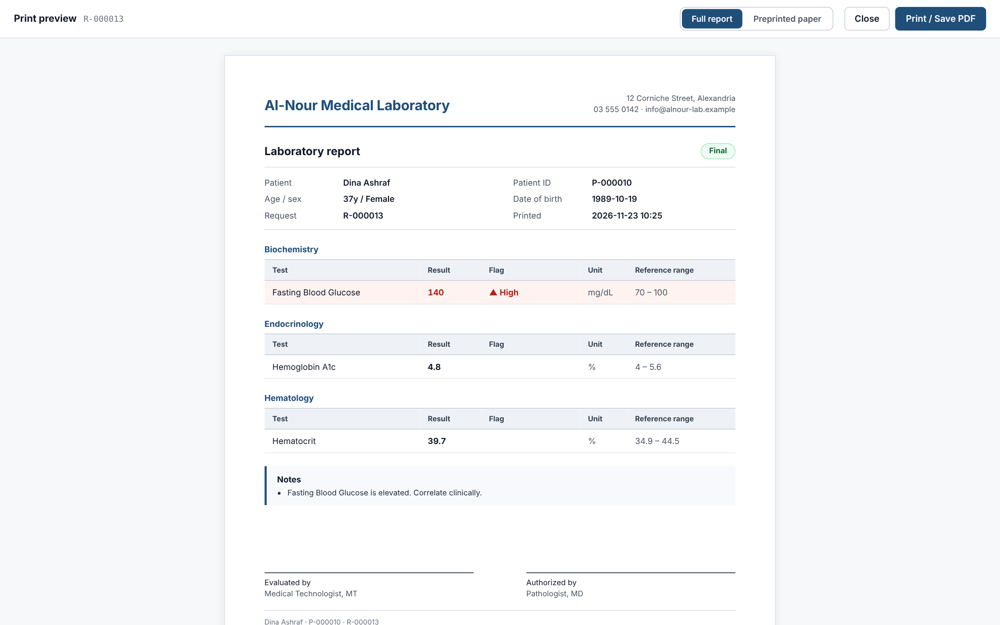
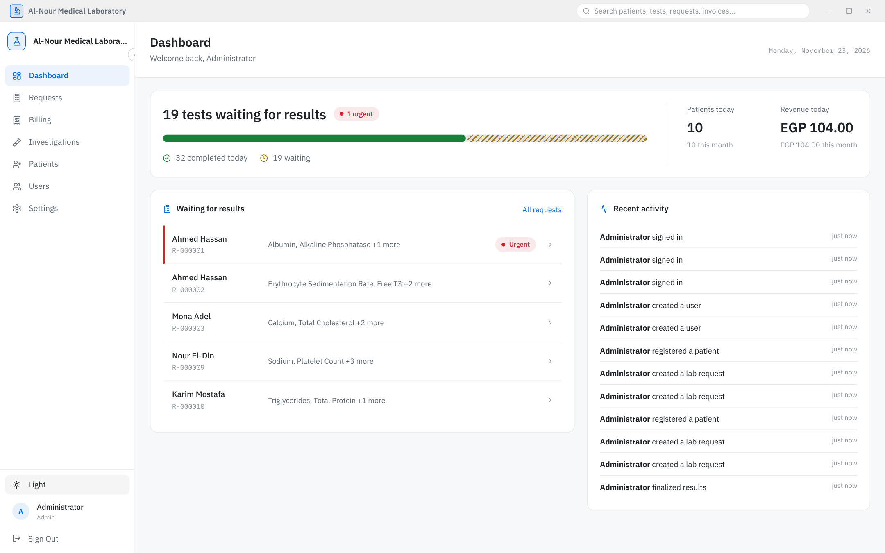

# LMS: Laboratory Management System

A fast, offline-first desktop app for running a small clinical laboratory: register patients, take test requests, enter and finalize results, print reports, and handle billing. All data stays on your machine in a local SQLite database.

> **Alpha (`0.1.0-alpha.1`).** Usable for evaluation and testing, not yet recommended as the only record system of a live lab. See [Known limitations](#known-limitations).



## Features

- **Patients**: registration, search, history
- **Requests**: pick individual tests or predefined profiles, track status from pending to completed, urgent flag
- **Results entry**: units, age- and sex-specific reference ranges, automatic High/Low flags, per-result notes, finalize
- **Reports**: print-ready reports with your lab header, single or batch (one sheet per patient), full or pre-printed-paper layout
- **Billing**: invoices, partial payments, receipts
- **Test catalogue**: ships with a seeded list of investigations; edit categories, tests, profiles and reference ranges
- **Global search** across patients, tests, requests and invoices (SQLite FTS5)
- **Users and roles**: admin, technician, receptionist, viewer; every command is authorized on the backend, and sessions expire after 12 hours
- **Backup and restore** from Settings, plus an automatic backup at startup
- **Regional settings**: currency and date format; light and dark themes

## Screenshots

| | |
|---|---|
|  |  |
|  |  |
|  |  |

Light theme:



*The screenshots use fictional demo data.*

## Install

Download the installer for your OS from the [latest release](../../releases):

- **Windows**: the `.exe` (NSIS) installer
- **Linux**: the `.AppImage` or `.deb`

Alpha builds are not code-signed, so Windows SmartScreen may warn you; choose "More info" then "Run anyway".

### First login

Sign in with username `admin` and password `admin`, then **change the password immediately** under Users. Create accounts for the rest of your staff from the same page.

## Tech stack

| Layer | Tools |
|---|---|
| Shell | [Tauri 2](https://tauri.app) |
| Backend | Rust, SQLite (rusqlite, FTS5) |
| Frontend | React, TypeScript, Zustand, React Router (HashRouter), Vite |
| Tooling | pnpm, [tatr](https://github.com/) task tracker, GitHub Actions |

## Build from source

Prerequisites: Node 22+, pnpm, a Rust toolchain, and the [Tauri system dependencies](https://tauri.app/start/prerequisites/) for your OS.

```bash
pnpm install
pnpm tauri dev      # run in development
pnpm tauri build    # production bundles
```

In debug builds the database is wiped on every start and filled with demo data (extra logins: `tech/tech`, `reception/reception`, `viewer/viewer`). Set `LMS_KEEP_DB=1` to keep the database between runs. Release builds never wipe data and never add demo data.

### Project layout

```
src/            React frontend (pages, stores, lib/api.ts)
src-tauri/src/  Rust backend (commands, auth, db, search, billing, seed)
src-tauri/seed/ Seed catalogue of investigations
tasks/          tatr task tracker
```

## Known limitations

- Alpha: the database schema may still change between alpha versions, and migrations are not guaranteed yet.
- The default `admin/admin` account must be changed by hand on first use.
- English interface only (Arabic is planned).
- Installers are unsigned.

## Clinical disclaimer

LMS is a record-keeping and reporting tool. Reference ranges and abnormal flags are aids only; results must be reviewed and authorized by qualified laboratory staff before release. The software is provided without warranty.

## License

[GPL v3](LICENSE)
